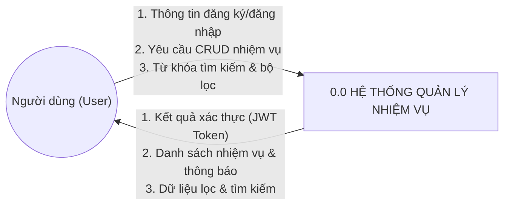
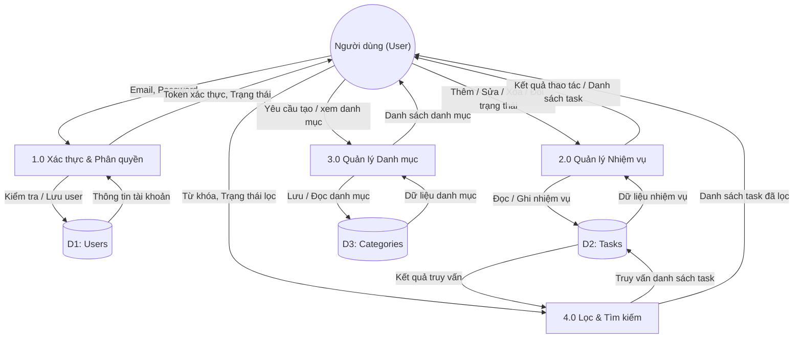

# TÀI LIỆU ĐẶC TẢ YÊU CẦU VÀ THIẾT KẾ HỆ THỐNG
**Đề tài:** Ứng dụng Quản lý Nhiệm vụ Cá nhân (Personal Task Manager / To-Do List Full-Stack)  
**Mã đề tài:** CNPM07 – Học kỳ HK261  
**Khoa:** Công nghệ Thông tin – Trường Đại học Văn Lang  
**Giảng viên hướng dẫn:** ThS. Trần Công Thanh  
**Đơn vị thực tập:** Xưởng  
**Người thực hiện tài liệu:** Nguyễn Hoàng Minh Nhật (MSSV: 2374802010363)  
**Nhóm sinh viên thực hiện:**
- Nguyễn Phạm Quang Thiện (Nhóm trưởng - BE & DB) – MSSV: 2374802011250
- Nguyễn Thái Khánh Hòa (FE) – MSSV: 2374802010147
- Nguyễn Hoàng Minh Nhật (Test & Tài liệu) – MSSV: 2374802010363

---

## PHẦN 1: ĐẶC TẢ YÊU CẦU HỆ THỐNG (REQUIREMENTS SPECIFICATION)

### 1.1. Bối cảnh và khảo sát hiện trạng tại đơn vị thực tập (Xưởng)
- **Hiện trạng:** Tại xưởng, việc phân chia và ghi nhận công việc hàng ngày của cá nhân chủ yếu thông qua sổ tay truyền thống, nhóm chat hoặc ghi nhớ thủ công. Cách làm này dễ dẫn đến tình trạng sót việc, khó theo dõi tiến độ các đầu việc quan trọng và không có sự phân loại ưu tiên rõ ràng.
- **Mục tiêu phần mềm:** Xây dựng một ứng dụng web gọn nhẹ, tốc độ cao, hỗ trợ người dùng theo dõi danh sách việc cần làm, phân loại theo nhóm công việc, đánh dấu trạng thái hoàn thành và tìm kiếm/lọc nhanh chóng.

---

### 1.2. Yêu cầu chức năng (Functional Requirements - FR)

| Mã Yêu Cầu | Tên Chức Năng | Mô Tả Chi Tiết | Độ Ưu Tiên |
| :--- | :--- | :--- | :---: |
| **FR-01** | **Đăng ký tài khoản** | Cho phép người dùng mới tạo tài khoản với họ tên, email, mật khẩu. Mật khẩu phải được mã hóa trước khi lưu trữ. | Cao (Tuần 2) |
| **FR-02** | **Đăng nhập & Xác thực** | Xác thực người dùng bằng Email/Password, cấp phát JWT (JSON Web Token) để duy trì phiên đăng nhập an toàn. | Cao (Tuần 2) |
| **FR-03** | **Xem danh sách nhiệm vụ** | Hiển thị toàn bộ các nhiệm vụ của người dùng đang đăng nhập, kèm trạng thái (hoàn thành / chưa hoàn thành), ngày tạo và danh mục. | **Cốt lõi (Tuần 1)** |
| **FR-04** | **Thêm mới nhiệm vụ** | Cho phép nhập tiêu đề nhiệm vụ (bắt buộc), mô tả chi tiết, chọn danh mục và hạn hoàn thành (deadline). | **Cốt lõi (Tuần 1)** |
| **FR-05** | **Cập nhật nhiệm vụ** | Cho phép chỉnh sửa tiêu đề, mô tả, thay đổi danh mục hoặc điều chỉnh deadline của nhiệm vụ đã tạo. | **Cốt lõi (Tuần 1)** |
| **FR-06** | **Chuyển đổi trạng thái (Toggle Complete)** | Bấm checkbox để đánh dấu nhanh nhiệm vụ đã hoàn thành hoặc chuyển lại chưa hoàn thành. | **Cốt lõi (Tuần 1)** |
| **FR-07** | **Xóa nhiệm vụ** | Cho phép xóa một nhiệm vụ khỏi danh sách. Hệ thống yêu cầu xác nhận trước khi xóa vĩnh viễn. | **Cốt lõi (Tuần 1)** |
| **FR-08** | **Quản lý danh mục (Categories)** | Cho phép tạo danh mục phân loại công việc (ví dụ: Công việc, Học tập, Cá nhân, Khẩn cấp) kèm mã màu trực quan. | Trung bình (Tuần 1-2) |
| **FR-09** | **Lọc nhiệm vụ** | Lọc danh sách theo trạng thái: *Tất cả*, *Đang làm (Chưa hoàn thành)*, *Đã hoàn thành*; hoặc lọc theo từng *Danh mục*. | Cao (Tuần 2) |
| **FR-10** | **Tìm kiếm nhiệm vụ** | Ô tìm kiếm thời gian thực cho phép tra cứu nhiệm vụ dựa trên từ khóa trong tiêu đề. | Cao (Tuần 2) |
| **FR-11** | **Thống kê tiến độ** | Hiển thị tổng số việc, số việc đã làm xong, số việc còn tồn đọng và phần trăm hoàn thành. | Thấp (Tuần 3) |

---

### 1.3. Yêu cầu phi chức năng (Non-Functional Requirements - NFR)

1. **Hiệu năng (Performance):**
   - Thời gian phản hồi của các RESTful API backend < 500ms trong điều kiện mạng bình thường.
   - Giao diện người dùng (Frontend React) tương tác mượt mà, phản hồi ngay lập tức khi người dùng thao tác bấm nút hoặc tick checkbox.
2. **Bảo mật (Security):**
   - Không lưu trữ mật khẩu dạng plain-text; sử dụng thuật toán băm `bcrypt` để mã hóa mật khẩu.
   - Các API nhạy cảm (thêm/sửa/xóa task) phải có middleware kiểm tra JWT token, bảo đảm người dùng chỉ xem và chỉnh sửa được dữ liệu của chính mình.
3. **Tính tương thích & Giao diện (Usability & Responsiveness):**
   - Thiết kế giao diện thân thiện, hiện đại, hỗ trợ hiển thị tốt trên các kích thước màn hình phổ biến (Desktop, Tablet, Laptop).
4. **Độ tin cậy & Toàn vẹn dữ liệu (Reliability & Data Integrity):**
   - Sử dụng hệ quản trị CSDL quan hệ PostgreSQL với các ràng buộc khóa chính (Primary Key), khóa ngoại (Foreign Key) chặt chẽ giữa các bảng `Users`, `Tasks`, `Categories`.

---

## PHẦN 2: SƠ ĐỒ PHÂN CẤP CHỨC NĂNG (BFD - BUSINESS FUNCTION DIAGRAM)

Sơ đồ BFD giúp phân rã cấu trúc hệ thống quản lý nhiệm vụ từ góc nhìn tổng quan đến từng tác vụ cụ thể:

```mermaid
graph TD
    Root["HỆ THỐNG QUẢN LÝ NHIỆM VỤ CÁ NHÂN (TO-DO LIST)"]

    F1["1. Quản lý Tài khoản"]
    F2["2. Quản lý Nhiệm vụ"]
    F3["3. Quản lý Danh mục"]
    F4["4. Tìm kiếm & Lọc"]

    Root --> F1
    Root --> F2
    Root --> F3
    Root --> F4

    F1_1["1.1 Đăng ký tài khoản"]
    F1_2["1.2 Đăng nhập hệ thống"]
    F1_3["1.3 Đăng xuất"]
    F1 --> F1_1
    F1 --> F1_2
    F1 --> F1_3

    F2_1["2.1 Xem danh sách nhiệm vụ"]
    F2_2["2.2 Thêm nhiệm vụ mới"]
    F2_3["2.3 Chỉnh sửa thông tin nhiệm vụ"]
    F2_4["2.4 Cập nhật trạng thái hoàn thành"]
    F2_5["2.5 Xóa nhiệm vụ"]
    F2 --> F2_1
    F2 --> F2_2
    F2 --> F2_3
    F2 --> F2_4
    F2 --> F2_5

    F3_1["3.1 Xem danh mục"]
    F3_2["3.2 Tạo danh mục mới"]
    F3_3["3.3 Gán màu đại diện"]
    F3 --> F3_1
    F3 --> F3_2
    F3 --> F3_3

    F4_1["4.1 Lọc theo trạng thái"]
    F4_2["4.2 Lọc theo danh mục"]
    F4_3["4.3 Tìm kiếm theo từ khóa"]
    F4 --> F4_1
    F4 --> F4_2
    F4 --> F4_3
```

---

## PHẦN 3: SƠ ĐỒ LUỒNG DỮ LIỆU (DFD - DATA FLOW DIAGRAM)

### 3.1. Sơ đồ luồng dữ liệu Mức 0 (Sơ đồ Ngữ cảnh - Context Diagram)
Mô tả sự tương tác dữ liệu tổng quan giữa Người dùng (Tác nhân ngoài) và Hệ thống Quản lý Nhiệm vụ:

**Mô tả luồng dữ liệu mức 0:**
- **Dữ liệu vào:** 
  - Thông tin đăng ký (họ tên, email, mật khẩu), thông tin đăng nhập (email, mật khẩu).
  - Yêu cầu thao tác nhiệm vụ (tiêu đề, mô tả, danh mục, trạng thái hoàn thành).
  - Điều kiện lọc và từ khóa tìm kiếm.
- **Dữ liệu ra:** 
  - Token xác thực đăng nhập, thông tin profile người dùng.
  - Danh sách nhiệm vụ kèm trạng thái tương ứng, thông báo kết quả thao tác (thành công/thất bại).

---

### 3.2. Sơ đồ luồng dữ liệu Mức 1 (Mức Đỉnh - Level 1 Diagram)
Phân rã các tiến trình xử lý chính và mối quan hệ với các kho dữ liệu (Datastores):

---

## PHẦN 4: THIẾT KẾ CSDL DỰ KIẾN (PHỐI HỢP VỚI THIỆN)

Để tài liệu đồng bộ với phần Backend của Thiện, dưới đây là cấu trúc 3 bảng dữ liệu dự kiến:

### 1. Bảng `Users`
| Tên Cột | Kiểu Dữ Liệu | Ràng Buộc | Ý Nghĩa |
| :--- | :--- | :--- | :--- |
| `id` | SERIAL / INT | PRIMARY KEY | Khóa chính tự tăng |
| `name` | VARCHAR(100) | NOT NULL | Họ và tên người dùng |
| `email` | VARCHAR(150) | UNIQUE, NOT NULL | Email đăng nhập |
| `password` | VARCHAR(255) | NOT NULL | Mật khẩu băm (bcrypt) |
| `created_at` | TIMESTAMP | DEFAULT CURRENT_TIMESTAMP | Thời điểm tạo |

### 2. Bảng `Categories`
| Tên Cột | Kiểu Dữ Liệu | Ràng Buộc | Ý Nghĩa |
| :--- | :--- | :--- | :--- |
| `id` | SERIAL / INT | PRIMARY KEY | Khóa chính tự tăng |
| `name` | VARCHAR(100) | NOT NULL | Tên danh mục (Công việc, Học tập,...) |
| `color` | VARCHAR(20) | DEFAULT '#3b82f6' | Mã màu hiển thị |
| `user_id` | INT | FOREIGN KEY (Users.id) | Khóa ngoại liên kết người dùng |

### 3. Bảng `Tasks`
| Tên Cột | Kiểu Dữ Liệu | Ràng Buộc | Ý Nghĩa |
| :--- | :--- | :--- | :--- |
| `id` | SERIAL / INT | PRIMARY KEY | Khóa chính tự tăng |
| `title` | VARCHAR(255) | NOT NULL | Tiêu đề nhiệm vụ (bắt buộc) |
| `description` | TEXT | NULL | Mô tả chi tiết nhiệm vụ |
| `completed` | BOOLEAN | DEFAULT FALSE | Trạng thái hoàn thành |
| `user_id` | INT | FOREIGN KEY (Users.id) | Khóa ngoại người sở hữu |
| `category_id` | INT | FOREIGN KEY (Categories.id), NULL | Khóa ngoại danh mục |
| `created_at` | TIMESTAMP | DEFAULT CURRENT_TIMESTAMP | Ngày tạo |
| `due_date` | DATE / TIMESTAMP | NULL | Hạn chót hoàn thành |

---

*Tài liệu này là cơ sở để Nhật xây dựng bộ kịch bản kiểm thử (Test Cases) ở Phần tiếp theo và hỗ trợ Thiện + Hòa đối chiếu tính năng trong quá trình code.*
